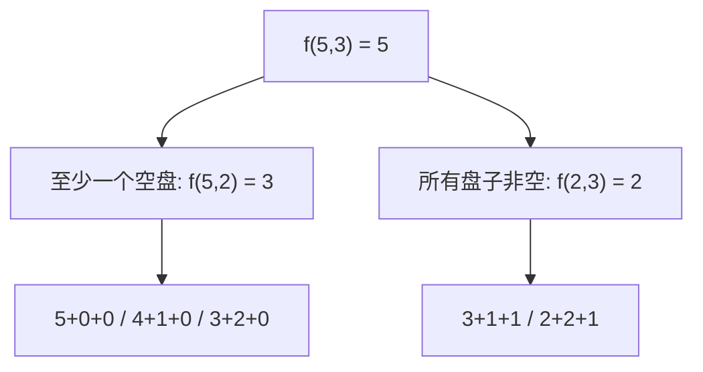

# C++ 编程日志｜近期问答、算法学习与调试复盘

> **整理日期**：2026-11-15  
> **覆盖范围**：本轮对话中近期的 C++ 学习与算法题讨论（**跨多日汇总**，不是断言所有问题都发生于 11 月 15 日）。  
> **记录原则**：保留“我问了什么 → 得到了什么解答 → 哪里写错/报错 → 怎样修复”，以便复习；只摘录具有代表性的代码，不机械复制全部聊天。  
> **核心主题**：字符串与容器、C++ 类型/输入输出、递归与 DFS、贪心、BFS、DP、常见报错。

---

## 0. 本期学习轨迹（目录）

| 方向 | 我问过的代表问题 | 掌握的关键点 |
| --- | --- | --- |
| STL 容器 | `map` 是什么、何时用、如何新增元素；`vector` 怎么清空和比较；`sort` 怎么排序结构体/指定下标 | `map[key]` 的行为；`push_back`、`clear`、`sort`、`stable_sort` |
| 字符串 | `reverse`、`pop_back`、`find`、`erase(unique(...))`、`isalnum`、`isdigit`、`stod` | 字符/字符串处理，`npos` 和有符号/无符号比较 |
| 输入与调试 | `EmptyOutput`、`stack::top()` 断言失败、`erase` 未声明、`Wrong Answer` | 先看读入、边界、输出路径，再看算法和类型范围 |
| 递归/DFS | 阶乘、分解因数、放苹果、合理消费、红与黑、旅行商 | 定义状态、终止条件、选择、递归、是否回溯 |
| 贪心 | 活动选择、最大乘积、排队看病 | 排序依据；局部最优必须证明；贡献法 |
| 其他算法 | 前缀表达式、区间合并、二叉树最近公共祖先、确定进制、K 进制小数加法、牛顿迭代 | 根据题目特性选择栈/排序/循环/枚举/迭代 |
| 进阶概念 | 天平 DP、位运算 `<<` / `&` / `|`、记忆化、`memset` | 先会普通递归，再理解状态去重与数值溢出 |

## 1. STL、字符串与 C++ 基础（问答记录）

### 1.1 `map` 是什么？什么时候使用？如何加元素？

**我的提问**：`C++ map是什么数据结构`、`什么时候可以用map`、`讲讲map怎么增加元素`、`如果元素不存在，是不是就mp[]返回0`。

**解答要点**：

- `std::map<K,V>` 存储**键—值对**，键唯一，按键排序；常见实现为平衡搜索树，插入/查找通常是 `O(log n)`。
- 适合“单词 → 次数”“学号 → 成绩”“某个键 → 对应结果”等映射关系。
- `mp[key] = value` 可新增或修改元素，`mp[key]++` 很适合计数。
- **关键区别**：`mp[key]` 在键不存在时会**插入**该键，其值会被**值初始化**。若值类型为 `int`，初值是 `0`；但不是所有类型都“返回 0”。
- 只查询而不想插入时，使用 `find()` / `count()`（或 C++20 `contains()`）。

```cpp
#include <map>
#include <string>
using namespace std;

map<string, int> mp;
mp["apple"]++;            // 第一次访问时先插入 apple:0，再自增为 1
mp["banana"] = 3;         // 插入 / 修改
if (mp.find("pear") == mp.end()) {
    // 没有 pear，且本次查询不会插入
}
```

### 1.2 `vector`、`string` 常用操作

**我的提问**：`两个vector可以直接比较吗`、`vector怎么清空`、`string有pop这个函数吗`、`reverse怎么用`。

- 相同元素类型的 `vector` 可以用 `==` 比较（元素个数相同且对应元素相等），也可用 `<` 等按**字典序**比较。
- `vector` 清空：`v.clear()`；移除最后一个：`v.pop_back()`；添加末尾：`v.push_back(x)`。
- `string` 也有 `pop_back()`、`push_back()`、`back()`、`erase()`、`size()`，但**没有名为 `pop()` 的成员函数**。
- `reverse` 定义在 `<algorithm>`，对迭代器区间原地反转。

```cpp
#include <algorithm>
#include <vector>
#include <string>
using namespace std;

vector<int> a = {1, 2, 3};
vector<int> b = {1, 2, 3};
bool same = (a == b);       // true
reverse(a.begin(), a.end()); // {3,2,1}
a.clear();                 // size 变成 0

string s = "hello ";
if (!s.empty() && s.back() == ' ') s.pop_back(); // "hello"
```

**易错点**：不要对空 `vector` / `string` 执行 `pop_back()`；`clear()` 不保证释放容量（`capacity`）。

### 1.3 `sort` / `stable_sort`：数组下标 1、结构体排序

**我的提问**：`直接用sort对元素结构体的vector排序会发生什么`、`sort函数排序数组，从下标1开始排，怎么写`。

- `sort(first, last)` 的区间为**左闭右开** `[first,last)`。
- 若数组的有效元素存于 `a[1]...a[n]`：`sort(a + 1, a + n + 1);`。
- 若数组大小为 `n`、想保留 `a[0]`：`sort(a + 1, a + n);`。
- 自定义结构体若没有合适的 `<` 运算符，直接 `sort(v.begin(),v.end())` 通常无法编译；可传比较函数 `cmp`。
- `stable_sort` 可在比较键相等时保留原始相对顺序。

```cpp
struct Patient { int id, time; };

bool cmp(Patient a, Patient b) {
    return a.time < b.time;
}

// stable_sort(v.begin(), v.end(), cmp);
```

### 1.4 字符判断、转义与类型转换

**我的提问**：`!isalnum((unsigned char)c) 何意味`、`'\'' 为什么要这么写`、`isdigit能判断double类型吗`、`string能转成double吗`、`static_cast<int>()是什么东西`。

- `isalnum(c)`：判断字符是否为字母或数字；前面的 `!` 表示“**不是**字母或数字”。
- 建议传入 `static_cast<unsigned char>(c)`，避免原始 `char` 为负值时的未定义行为。
- `isdigit()` 判断**一个字符**是否表示数字，不能判断 `double` 类型数值是否合法，也不能识别完整的负数/小数。
- 字符串转数值：`stod("3.14")` 得到 `double`；`stoi("123")` 得到 `int`。
- `\'` 是字符常量里的单引号转义，因此表示单引号字符的 C++ 写法是 ` '\'' `（两侧为单引号，内部以反斜杠转义）。
- `static_cast<int>(x)` 是**显式类型转换**；如 `static_cast<int>(3.9)` 得 `3`（截去小数）。

```cpp
#include <cctype>
#include <string>
using namespace std;

char c = '\'';                       // 一个单引号字符
bool delimiter = !isalnum(static_cast<unsigned char>(c));
double value = stod("12.50");
int trunc = static_cast<int>(value);  // 12
```

### 1.5 `find()`、`size_t`、`npos` 与子序列匹配

**我的提问**：`为什么第一个数据输出NO`、`怎么比较无符号整数和负数`、`if(static_cast<int>(b.find(c)) > pos)这样写可以吗`、`什么叫子序列匹配`。

**题目**：「简单的缩略语判断」——判断字符串 `A` 是否为字符串 `S` 的**真子序列**（顺序不变，可跳过字符，而且 `A.size() < S.size()`）。

逐次排查的错误：

1. `cin >> n` 后直接 `getline(cin, a, ':')`，导致首组 `a` 实际包含一个开头换行符，第一组意外输出 `NO`。应先忽略上一行尾部换行。
2. `int pos = -1; if (b.find(c) > pos)`：`find()` 返回无符号位置类型；与负数混合比较有转换陷阱。
3. `size_t pos = -1; b.find(c, pos)`：`-1` 被转换成极大的无符号整数，搜索直接失败。
4. `b.find(c, pos) > pos`：如果恰好在 `pos` 找到字符，这个判断仍为假；未找到时 `npos` 是极大值，也会产生错误。
5. `b.find(c)` 每次从头找，不保证字符按先后顺序被选中；还曾漏掉“**缩略语必须更短**”这一额外条件。

推荐写法：

```cpp
bool isAbbr(const string& a, const string& b) {
    if (a.size() >= b.size()) return false; // 题目额外要求真子序列
    size_t pos = 0;
    for (char c : a) {
        size_t found = b.find(c, pos);
        if (found == string::npos) return false;
        pos = found + 1;                     // 下次只能从后面继续找
    }
    return true;
}
```

**要牢记**：

- 子串要求**连续**；子序列允许**不连续，但顺序不能变化**。
- `std::string::find(c, pos)` 里的 `pos` 是**这次搜索的起点**，不是“上次的下标”。
- 若确实要将 `find()` 的结果转成 `int`，**先检查 `!= string::npos`**，确认有效位置在 `int` 可表示范围内。

### 1.6 `erase(unique(...))` 的编译错误

**我的报错**：`'erase' was not declared in this scope`，原语句类似：

```cpp
// 错误：erase(unique(af.begin(), af.end()), af.end());
```

`erase()` 是 `vector` 的**成员函数**，必须指出容器对象；去重前通常还要先排序以确保重复元素相邻：

```cpp
sort(af.begin(), af.end());
af.erase(unique(af.begin(), af.end()), af.end());
```

`unique` 会将相邻重复项移到逻辑末尾，返回新的逻辑终点；真正删掉尾部元素要靠 `erase`。

---

## 2. 输入输出与调试：我实际踩过的坑

### 2.1 `EmptyOutput`：文字排版题

**我的代码问题**：先读取整数 `n`，又用 `getline()` 获取后续文本，并且在循环里只有超过 80 字符或 `i == n` 时才输出。

**为什么会没输出**：

- `cin >> n` 后残留换行，紧接的 `getline()` 读到空串，导致 `stringstream` 提取不到单词。
- `int i = 1` 却从未 `i++`，`i == n` 经常始终为假。
- 只在换行条件成立时输出，**循环结束遗漏了最后一行**。
- 题目给的是 `n` 个单词，而不是保证全部词在同一输入行；只 `getline` 一次可能丢数据。

更稳妥的读取方式：

```cpp
cin >> n;
string word, line;
for (int i = 0; i < n; ++i) {
    cin >> word;
    string candidate = line.empty() ? word : line + " " + word;
    if (candidate.size() > 80) {
        cout << line << '\n';
        line = word;
    } else {
        line = candidate;
    }
}
if (!line.empty()) cout << line << '\n'; // 别漏掉最后一行
```

**通用排错原则**：先用 `cerr` 查看 `n`、`line`、`word` 是否读取正确；输入正确后再检查是否实际走到了 `cout`。

### 2.2 `cin` 与 `getline` 混用

**常见现象**：输入 `6\nAB:...`，执行 `cin >> n` 后使用 `getline(cin,a,':')`，可能读到 `a="\nAB"`，从而导致匹配失败。

```cpp
#include <limits>
cin >> n;
cin.ignore(numeric_limits<streamsize>::max(), '\n');
```

如果输入是直接按空白分隔的 n 个词，优先用 `cin >> word`；如果每行有空格且要完整保留，才用 `getline`。

### 2.3 `stack::top()` 断言失败：前缀表达式

**我的报错**：

```text
std::stack<...>::top(): Assertion '!this->empty()' failed
```

**含义**：栈为空却调用了 `top()`（或 `pop()`），通常是弹出了超过栈内实际元素的数量。

前缀表达式从**右往左**扫描；遇到数字压栈，遇到运算符需要取出**两个**操作数。因此 `st.size() >= 2` 是最基本的安全条件。之前写的 `if (st.size() > 2)` 又多限制了一层，会误跳过恰好两个操作数的合法情况。

其他错误包括：

- `isdigit(s[i])` 只能处理单个字符，不适合多位浮点数 `11.0` 或负数；应把用空格分隔的 token 作为字符串读入，调用 `stod()` 转换。
- 把空格当作运算符会引起误判；要明确区分数字 token 与 `+ - * /`。
- 栈顶不能在空栈时直接访问。

### 2.4 DFS 代码的 `No Output`

**合理消费题**里，`dfs()` 只有当 `remain == 0` 才打印。如果没有任何方案恰好花完钱，函数会结束但不会打印。应设置 `found` 标记，最后若没有方案则输出 `NO`。

```cpp
bool found = false;
// 在 DFS 找到合法方案时：found = true;
// main 中 dfs(...) 执行完后：
if (!found) cout << "NO\n";
```

**注意**：判题提示 `No Output (nothing printed or program died)` 并不能唯一证明“没有方案”，也可能是死循环、异常退出或搜索量过大；需要结合实际测试继续诊断。

### 2.5 `Wrong Answer` + 大负数：天平计数溢出

在「天平」DP 题中，曾出现：

```text
Std: 581550411
Out: -1883572905105047221
```

报错用例的真实方案数量为 **16,563,171,168,604,504,395**，已经超过 `long long` 范围，因此使用 `vector<long long>` 的中间加法会发生有符号整数溢出。

此次判题数据出现了特殊情况：标准结果等于真实方案数 `mod 2^32` 的值 **581550411**，与题面“答案在 `int` 范围内”的文字保证不一致。为匹配此判题，可用 `uint32_t` 累加（标准定义的模 `2^32` 运算），然后转换成判题预期的 32 位有符号值；若题目真正要求**精确**方案总数，就要使用高精度整数，不能把取模解当成真实总数。

**教训**：当输出离谱的负数，优先检查乘法、累加的数值范围；不要只看最终答案是否“应该能装进 int”。

---

## 3. 递归函数怎么设计？DFS 与回溯怎么理解？

### 3.1 我反复问到的基础问题

- “怎么写一个递归函数？”
- “这是深搜吗？递归函数怎么没有 return？”
- “我不知道什么时候该用深搜。”
- “一个 dfs 函数应该怎么写？”
- “我总是不知道怎么设计递归函数。”
- “我不太明白回溯的原理。”

**总结为四个问题**：

1. `dfs(参数)` 的一句话含义是什么？即**状态**。
2. 什么时候算完成或失败？即**终止条件**。
3. 当前可以做什么？即**枚举选择**。
4. 下一层结束后，哪些共享变量需要恢复？即**回溯**。

通用框架：

```cpp
void dfs(/* 当前状态 */) {
    if (/* 完成或失败 */) {
        // 记录答案（如果需要）
        return;
    }
    for (/* 每个合法选择 */) {
        // 做选择：修改共享状态
        dfs(/* 更小或更深的状态 */);
        // 撤销本层修改：恢复共享状态
    }
}
```

**关于 `return`**：`void dfs()` 不需要返回数值。`return;` 只是提前退出本层函数。像“阶乘”这样需要向上一层**提供计算结果**时，可以声明 `int factorial(int n)` 并 `return n * factorial(n-1)`。

### 3.2 「合理消费」：组合枚举 DFS

题目给商品价格列表，每件可买无限次，要输出所有总价恰好等于 `p` 的方案，且交换顺序不算新方案。

**我最初写错**：

```cpp
// 不建议：函数一进来就默认扣掉 price[start]
int remain = p - price[start];

// 错误：修改了“价格表”，而不是当前购买路径
price.push_back(price[i]);

// 错误：把 pop_back 放进不能购买时的 else 分支
else { path.pop_back(); return; }
```

**修正后的核心**：

```cpp
vector<int> price, path;
int n;

void dfs(int remain, int start) {
    if (remain == 0) {
        // 输出或记录 path
        return;
    }
    for (int i = start; i < n; ++i) {
        if (price[i] <= remain) {
            path.push_back(price[i]);
            dfs(remain - price[i], i); // 同种商品允许多次购买
            path.pop_back();          // 恢复到选择前
        }
    }
}
```

**为什么是 `i` 而不是 `i+1`**：商品可重复购买，下一层仍然允许选同一种商品；限制下标不回退，则同一组合不会因排列顺序不同而重复计数。

**回溯的真实含义**：`push_back → dfs → pop_back` 是“做出选择 → 穷尽此选择下的可能 → 撤销本层选择”；即便已经找到了有效答案，也需要撤销以探索其他方案。

### 3.3 「红与黑」：网格 DFS（不需要撤销 visited）

题目中 `@` 起点、`.` 可通行、`#` 不可通行，求从起点能到达的瓷砖数（**包括起点**）。

**我实际提交的 DFS 问题**：

| 原写法 | 为什么错 | 修复 |
| --- | --- | --- |
| `maze[x][y] != '.'` | 起点 `@` 被排除，`ans` 一直是 0 | 只屏蔽 `maze[x][y] == '#'` |
| `visited[x][y] == true;` | `==` 是比较，不会修改标记 | `visited[x][y] = true;` |
| 先访问 `maze[x][y]` 再检查边界 | `dfs(-1,y)` 时已经越界 | **先边界判断，再访问数组** |
| `x == W || y == H` | `x` 是**行**，范围由 `H` 控制；`y` 是列，由 `W` 控制 | `x >= H || y >= W` |

```cpp
void dfs(int x, int y) { // x: 行; y: 列
    if (x < 0 || x >= H || y < 0 || y >= W) return;
    if (maze[x][y] == '#' || visited[x][y]) return;
    visited[x][y] = true;
    ++ans;
    dfs(x - 1, y);
    dfs(x + 1, y);
    dfs(x, y - 1);
    dfs(x, y + 1);
}
```

**为什么这里不 `visited[x][y] = false`？** 目标是每个可达位置只统计一次，而不是枚举所有路径。永久标记可以防止绕圈和重复计数。

**多组输入**：`while (cin >> W >> H && (W != 0 || H != 0))`；每组重置 `ans`、`visited` 并读入 `H` 行地图。

### 3.4 「放苹果」：递归分类，而不是枚举每一条路径

我写的代码已经 AC：

```cpp
int f(int m, int n) {
    if (m == 0 || n == 1) return 1;
    if (m < n) return f(m, n - 1);
    return f(m - n, n) + f(m, n - 1);
}
```

**`f(m,n)` 定义**：把 `m` 个**相同**苹果放进 `n` 个**相同**盘子，允许空盘，不计排列顺序的方案数。

两种**互斥且穷尽**的情况：

- **至少一个空盘**：去掉一个空盘，得到 `f(m,n-1)`。
- **所有盘子都非空**：每盘先放一个，剩 `m-n` 个，得到 `f(m-n,n)`。

所以 `m>=n` 时：

\[
f(m,n)=f(m,n-1)+f(m-n,n).
\]

当 `m<n` 必然有空盘，所以只保留 `f(m,n-1)`。结束条件 `m==0` 或 `n==1` 都只有一种放法。

**实例**：`f(5,3) = f(5,2) + f(2,3) = 3 + 2 = 5`。



**最重要的认识**：普通递归可以**分类计算子问题并相加**，而不一定需要像 DFS 那样记录 `path` 与执行 `pop_back()`。

### 3.5 其他 DFS / 递归题目

| 题目 | 我问过什么 / 得到的解法 |
| --- | --- |
| 1090「分解因数」 | DFS 枚举不小于前一个的因子，避免 `2×10` 与 `10×2` 重复；`void dfs` 可以直接通过全局计数器累计答案。 |
| 「猴子分苹果」 | 讨论了从小规模模拟、递归与反向思考入手；注意每只猴子都丢弃 k 个苹果，且最后一只分配后仍至少拿到 1 个。 |
| 「旅行售货商」TSP | `dfs(current,count,sum)` 枚举下一座**未访问**城市；完成所有城市后要加返回起点的费用；朴素 DFS 在 `n<=15` 可能超时，进阶做法是记忆化 / 状态压缩 DP。 |
| 「左手定则」 | **不是**回溯 DFS；根据“左、前、右、后”优先顺序模拟移动。记录 `(行,列,朝向)` 状态以检测循环。 |
| 「小游戏」连线 | 求的是**最少直线段数**，不是最短移动格数；适合按线段分层的 BFS，路径允许从棋盘外侧绕过。 |
| 「天平」 | DFS 状态 `dfs(index, torque)`：给第 `index` 个重物选择挂钩，力矩增加 `weight[index]*hook[j]`；方案过多时改为 DP 合并相同 `(已放重物数, 力矩)`。 |

---

## 4. 贪心算法：怎样选择“每一步最优”？

### 4.1 我问过的关键问题

- “什么是贪心算法？”
- “为什么按结束时间排序一定能得到最多的活动数量？”
- “最大乘积这道题为什么第二轮剩余最多只可能是 1？”
- “排队看病这道题是贪心吗？我的实现哪里有问题？”

**核心**：贪心算法在每一步做局部最优选择，但**必须证明**这种选择不会破坏全局最优；“看起来合理”并不够。

### 4.2 「活动选择」：按结束时间排序

目标：在一间教室中安排尽可能多的互不冲突活动；结束时刻等于下一活动开始时刻可相容。

**策略**：按结束时间递增排序，从前往后挑选 `start >= lastEnd` 的活动。

```cpp
struct Activity { int start, end; };
bool cmp(Activity a, Activity b) { return a.end < b.end; }
// sort(v.begin(), v.end(), cmp);
// if (v[i].start >= lastEnd) { ++ans; lastEnd = v[i].end; }
```

**为什么对（交换论证）**：设最优方案第一个活动为 `O`，全局结束最早的活动为 `G`；有 `end(G) <= end(O)`，把 `O` 换成 `G` 不会妨碍后续活动，也不会减少所安排活动数。剩余问题继续同样处理。

### 4.3 「排队看病」：按耗时从短到长

目标：让全体病人的**平均等待时间最少**。策略是短作业优先，即看病时间短者先看。

**我的实际代码错误与修复**：

1. 读取了 `Patient x`，却**忘记 `a.push_back(x)`**，导致 `vector` 一直为空，后续 `a[i]` 越界。
2. 排序后打印了 `a[i].time`，但题目要求输出的是病人**原始编号** `a[i].id`。
3. 原公式 `if (i > 0) sum += (n-i)*a[i].time;` 不对，既漏掉第一个病人的贡献，也把“后面的人数”算错。

**正确的贡献法**：零基下标第 `i` 人的看病时间会影响后面 `n-i-1` 个人。

\[
\text{平均等待时间} = \frac{\sum_{i=0}^{n-1}(n-i-1)\,t_i}{n}.
\]

```cpp
long long sum = 0;
for (int i = 0; i < n; ++i) {
    cout << a[i].id << (i+1 == n ? '\n' : ' ');
    sum += 1LL * (n-i-1) * a[i].time;
}
cout << fixed << setprecision(2) << static_cast<double>(sum)/n << '\n';
```

需要 `#include <iomanip>`；`stable_sort` 可以保留相同耗时者原先的编号顺序。

### 4.4 「最大乘积」：将不同正整数之和固定，乘积尽量大

先从 `2,3,4,...` 逐个取最小的互不相同正整数，直到不能再取下一项；然后把剩余的数**从右往左**平均加给已选择的数，最后若还剩 1，加给最大的数。

**我追问**：“为什么第二轮 `for` 循环结束后，若还有剩余，最多只有 1？”

假设选到 `2,3,...,k`，共有 `k-1` 个数。不能再选 `k+1`，故剩余 `r<k+1`，即 `r<=k`。第二轮每个数最多分配 `1`，一共能分配 `k-1`，故若仍有剩余：

\[
r-(k-1)\le1.
\]

这只是**该特定选择方式**带来的性质，并非所有贪心题都如此。

---

## 5. 按题型选算法（近期题目速查）

| 题目 | 推荐算法/方法 | 识别特征 |
| --- | --- | --- |
| 统计单词 | `map` 计数 + 单独记录首次出现顺序的 `vector` | 既统计次数，又要保留**首次出现顺序**；注意标点（如 `Haven't`） |
| 区间合并 | 结构体 + `sort` + 一次扫描 | 按左端点排序，维护目前已合并区间的右端点 |
| 前缀表达式求值 | 栈 `stack<double>`，从右往左处理 token | 每个运算符需要两个操作数；数字可能是浮点数 |
| 质因数分解 | 试除法，可写成递归 | 从 2 开始尝试因子，逐步缩小原数 |
| 阶乘 / 排列数 | 循环或递归实现 | C++ 没有像 `factorial()` 这种通用标准库函数可直接计算所有阶乘 |
| 1090「分解因数」 | DFS + 限制因子不降序 | 枚举所有乘积拆分而不重复 |
| 「合理消费」 | 组合型 DFS + 回溯 | 可重复选商品，输出所有符合总价方案 |
| 「最大乘积」 | 贪心 | 固定总和、元素互异，追求最大乘积 |
| 「活动选择」 | 贪心：按结束时间排序 | 最大化互不冲突活动数 |
| 「排队看病」 | 贪心：按处理时间排序 | 最小化平均等待时间 |
| 「放苹果」 | 分类递归 / 记忆化 / DP | 相同苹果、相同盘子，组合数与顺序无关 |
| 「二叉树」最近公共祖先 | 循环让编号较大的结点 `/=2` | 完全二叉树编号规则 `parent(i)=i/2` |
| 「红与黑」 | 网格 DFS | 统计起点所在连通块大小 |
| 「旅行售货商」 | 状态压缩 DP；普通 DFS 仅适合教学或小数据 | 每城恰好一次并返回起点，求最短环游 |
| 「天平」 | DP 统计力矩之和 | 不同挂法可能得到同一个力矩状态 |
| 「确定进制 1072」 | 枚举 B=2..16 + 霍纳法转换 | 候选答案范围非常小，验证容易 |
| 「任意 K 进制长纯小数加法」 | 字符串高精度加法 | 小数部分最长 100 位，不能依赖 `double` 精确表示 |
| 「左手定则」 | 确定性模拟 + 状态判重 | 移动方向完全由规则指定，无需遍历所有路线 |
| 「小游戏」连线路径 | BFS（每条直线段为一步） | 最少**线段**，不是最少格子；可走棋盘外侧 |
| 牛顿迭代求平方根 | `while` 循环迭代 | `x_next = (x+a/x)/2`，以相邻两次结果差作为停止条件 |
| 「代码查重」条件语句计数 | 逐字符扫描 / 提取完整标识符 | 区分 `if/switch` 与 `while/for`，避免误统计普通单词中的子串 |

### 5.1 「确定进制 1072」的核心公式

```cpp
// 将一串只含数字 0~9 的字符按 B 进制解释
result = result * B + (c - '0');
```

逐位判断 `(c-'0') < B`，从 `B=2` 到 `16` 枚举，首次满足 `p*q==r` 的就是最小合法进制；找不到输出 `0`。

### 5.2 「任意 K 进制纯小数加法」

- 两个字符串取小数点后的部分，**在末尾补 0** 对齐小数位。
- 从右往左相加：`digit = sum % K`、`carry = sum / K`。
- 删除答案小数部分结尾的 `0`；**即使小数部分全是零，也要保留小数点**，例如 `0.499 + 0.501` 输出 `1.`。

### 5.3 「二叉树」最近公共祖先 LCA

**我问过**：“题目要干嘛？” 理解之后发现不用真的建树：父结点编号为 `x/2`（整数除法）；让编号较大者不断向上移动直到相等。

```cpp
while (x != y) {
    if (x > y) x /= 2;
    else y /= 2;
}
cout << x << '\n';
```

例子：`10 -> 5 -> 2 -> 1`，`4 -> 2 -> 1`，最近公共祖先为 `2`。

### 5.4 牛顿迭代求平方根

```cpp
double x = 1.0;
while (true) {
    double next = (x + a / x) / 2.0;
    if (fabs(next - x) <= 1e-5) {
        x = next;
        break;
    }
    x = next;
}
cout << fixed << setprecision(7) << x << '\n';
```

题目禁止直接用 `sqrt()`；`fabs()` 是浮点数绝对值函数，`fixed << setprecision(7)` 输出 7 位小数。

---

## 6. `memset`、`sizeof`、动态规划与位运算（新概念）

### 6.1 `memset` 的正确认识

**我的提问**：`怎么把bool二维数组和char二维数组清零`、`讲讲memset`。

`memset(地址, 字节值, 字节数量)` **按字节填充**：

```cpp
#include <cstring>
bool visited[25][25];
char maze[25][25];
memset(visited, 0, sizeof(visited)); // 所有元素为 false
memset(maze, 0, sizeof(maze));       // 所有字符为 '\0'
memset(maze, '.', sizeof(maze));     // 每字节填为 '.'
```

**踩坑提醒**：

- `memset(intArray, 1, sizeof(intArray))` **不是**把每个整数变为 `1`，而是把每个字节设置为 `0x01`；应使用 `fill(a,a+n,1)`。
- `memset(...,-1,...)` 对主流补码整数常见有效，但要追求可移植性宜用 `fill()`。
- 不能 `memset` 整个 `vector` 对象；应使用 `vector::assign`、`std::fill`。
- 对于每组都会重新读满的迷宫，通常只需要重置 `visited` 和计数器，不必每次都清空整个 `maze`。

### 6.2 我不熟悉的 DP / 位运算

**我的提问**：`什么 dp, <<, |, &, memset, cstring`。

- `dp` 是 dynamic programming（动态规划）的习惯变量名，**不是 C++ 关键字**。
- 记忆化：相同子问题算过一次就复用答案。
- 整数上的 `1 << i` 是左移；`&`、`|` 可以进行按位与/按位或，常用来把某一位标记为已访问。
- `cout << x` 里的 `<<` 是输出流插入运算符（与整数位移不是同一语境）。
- `<cstring>` 提供 `memset` 等 C 风格内存操作函数。
- 旅行售货商在 `n<=15` 时更适合**状态压缩 DP**，复杂度约 `O(n^2 * 2^n)`；目前学习路线可以先掌握普通 DFS，再学记忆化和 DP。

### 6.3 天平 DP：状态是“已放重物数 + 力矩和”

`dp[i][sum]` 表示前 `i` 个重物已经分配、总力矩为 `sum` 的方案数量；第 `i` 个重物重量 `w`，挂到位置 `x` 后：

\[
dp[i+1][sum+w\cdot x] \mathrel{+}= dp[i][sum].
\]

由于 `sum` 可能为负，数组下标要加偏移（本题最大绝对力矩不超过 `20 * 25 * 15 = 7500`）。

---

## 7. 报错与逻辑错误总表（快速复盘）

| 报错 / 现象 | 根因 | 以后优先检查 |
| --- | --- | --- |
| `EmptyOutput` | `getline` 读到残留换行；没走到输出条件；漏输出最后一行 | 输入缓冲、循环是否执行、尾行是否打印 |
| `stack::top(): Assertion '!this->empty()' failed` | 对空栈调用 `top` | `size()>=2` 后才能提取两个操作数 |
| `'erase' was not declared in this scope` | 成员函数写成了全局调用 | `v.erase(unique(...),v.end())` |
| 缩略语第一组输出 `NO` | `cin >> n` 和 `getline` 混用引入换行 | `cin.ignore(...,'\n')` |
| 缩略语仍 `NO` / 错误匹配 | `size_t pos=-1`，`find()>pos`，未从正确位置搜索 | `size_t pos=0; found=b.find(c,pos);` |
| 字符串/结构体排序编译失败 | 没有适用的比较规则 | 给 `sort` 传 `cmp` |
| `No Output`（合理消费） | 没有可行方案时没有打印 `NO`；也可能搜索超时 | `found` 标记、测试搜索规模 |
| `void` 函数不能 `cout << dfs(...)` | `void` 没有返回值 | 将答案存全局变量或将函数改为有返回值 |
| DFS 重复枚举排列 | 同一组合按不同顺序重复搜索 | 用 `start` 约束下标，按题目决定是否允许重复选 |
| 「红与黑」一直输出 0 | 起点 `@` 被当成障碍物 | 只排除 `#`；把起点算进去 |
| DFS 无限循环 | `visited[x][y] == true;` 写成比较 | `visited[x][y] = true;` |
| 二维数组访问异常 | 越界判断放在取值后；W/H 对应反了 | **先**边界，再访问 `maze[x][y]` |
| 天平输出巨大的负数 | 中间方案数溢出 `long long` | 判断是否需要高精度或特定判题行为 |
| 排队看病数组越界 | 忘记 `a.push_back(x)` | 容器 `size()` 是否与预期一致 |
| 排队看病答案不对 | 打印了时间而非编号；等待时间贡献公式错 | `id` 与 `time` 区分、公式 `n-i-1` |
| K 进制小数结果错误 | 补零方向错或删掉了必须保留的小数点 | 小数补**右侧**，末尾去零，保留 `.` |

---

## 8. 每次写题前的自检清单

- [ ] 读懂输入：是给 `T` 组、读到 EOF，还是以 `0 0` 结束？是否夹杂整行文本？
- [ ] 定义含义：`x/y` 是行列还是横纵坐标？`W/H` 分别对应哪一个范围？
- [ ] 检查容器：读入后是否真的 `push_back`？`vector.size()` 是否等于 `n`？
- [ ] 检查边界：数组下标是否合法？`sort` 是左闭右开区间？
- [ ] 检查返回类型：`void` 函数不产生可用于 `cout` 的值。
- [ ] 检查递归状态：参数是否代表**下一层真正需要知道的信息**？
- [ ] 检查递归结束：成功/失败条件是否会停止搜索？
- [ ] 检查回溯：修改了共享的 `path` / `visited`，是否需要恢复？
- [ ] 检查输出：无解时是否输出 `NO`？最后一行有没有输出？
- [ ] 检查数值类型：`int` / `long long` 会不会溢出？`size_t` 是否与负数比较？
- [ ] 检查算法效率：朴素 DFS 在上限数据是否会爆炸？能否剪枝、记忆化、DP？
- [ ] 检查贪心依据：是否能举出反例或用交换论证证明排序规则？

## 9. 接下来的学习重点

1. **继续独立设计递归函数**：先说出 `dfs(参数)` 的含义，再写边界/选择/回溯。
2. **强化输入与输出调试**：`cin` / `getline` / `stringstream`，尤其是 `EmptyOutput` 场景。
3. **练习贪心正确性证明**：活动安排的交换论证、排队看病的贡献法。
4. **为 DP 铺路**：先找出 DFS 中重复计算的状态，再理解记忆化。
5. **养成记录错误写法的习惯**：同一种问题（`==` 写成 `=`、越界、漏 `push_back`、溢出）不重复踩坑。

---

### 后续每日编程日志模板（建议）

```markdown
# YYYY-MM-DD 编程日志｜今天的简短主题

## 今日问题与解答
### Q1. 我问了什么？
- 题目/原始代码：
- 解答与核心思路：
- 最重要的一句话：

## 报错与错误写法
| 现象 | 错误代码 | 原因 | 修正代码 |
| --- | --- | --- | --- |

## 今日新学到的知识

## 明天要复习的 1～3 个点
```

**文件名约定**：`YYYY-MM-DD_编程日志_简短主题.md`，例如 `2026-11-15_编程日志_递归DFS-贪心排错.md`。无编程提问的日期，不需要生成空日志。
