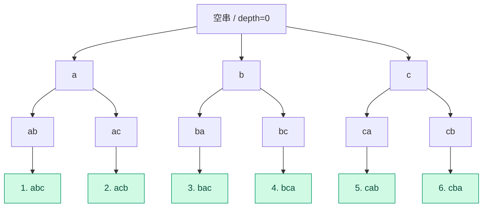
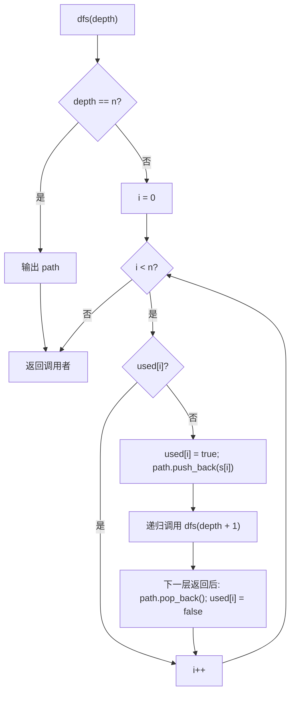
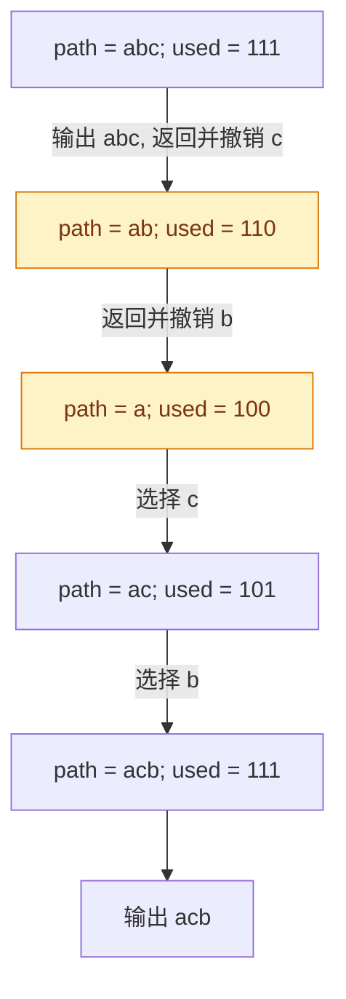
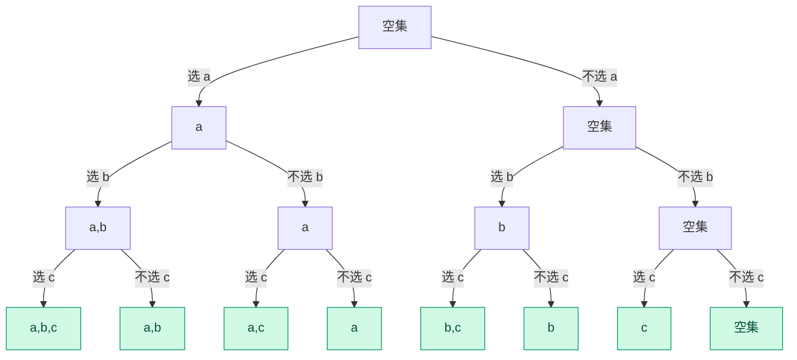
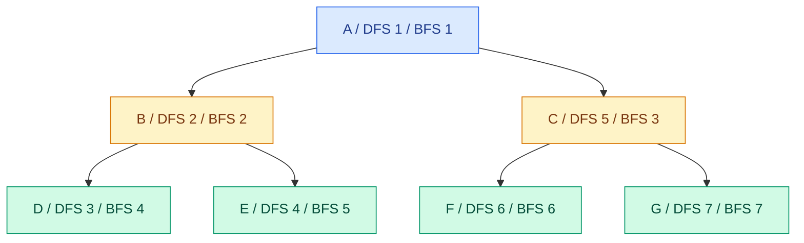
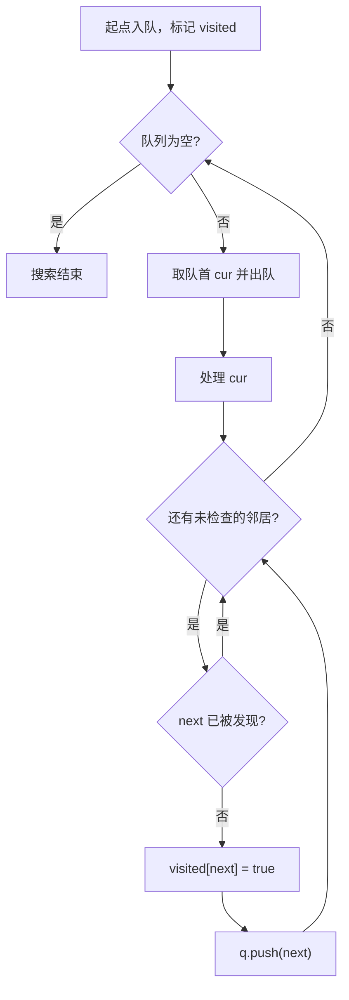
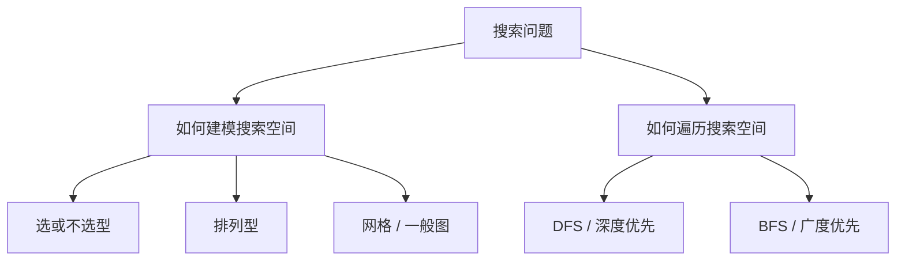

# 2026-11-25 编程日志｜全排列与 DFS / BFS

> 记录范围：北京时间 2026-11-25 截至 23:27 可获取的编程对话（提前版）。
> 数学公式采用 Markdown 的 `$...$` 和 `$$...$$` 格式，适合启用数学渲染的 Obsidian、Typora 等编辑器。
> Mermaid 图示增强版：保留原日志学习内容，用原生 Markdown Mermaid 绘图，支持启用 Mermaid 渲染的 Obsidian。
> 下面明确区分实际提问、实际报错、参考实现和复盘补充；没有把未发生的错误记为用户的错误。

## 1. 今日学习路线

今天围绕「全排列」完成了一次从 STL 到搜索算法的学习：

1. 排查 `do...while` 的括号语法错误。
2. 理解 `next_permutation` 的原地修改与布尔返回值。
3. 手写排列型 DFS：`path`、`used` 与回溯。
4. 对比排列型 DFS 和选或不选型 DFS。
5. 学习 BFS 的队列实现、逐层搜索和无权图最短路。
6. 使用 HTML 交互动画观察全排列的递归调用与恢复状态。

核心认识：**构建怎样的搜索空间，与按照什么顺序访问搜索空间，是两件不同的事。**

---

## 2. 实际编译报错：`next_permutation` 与 `do...while`

### 2.1 原始问题

用户提问：“何意味”。

VS Code / C++ 编译器输出：

```text
D:\C++ files\PKU 计算概论A\字符串\全排列.cpp:15:47: error: expected ')' before ';' token
   15 |     } while (next_permutation(s, s + s.size());
      |             ~                                 ^
```

### 2.2 错误一：少了右括号

原代码：

```cpp
} while (next_permutation(s, s + s.size());
```

`while (`、`next_permutation(` 和 `size(` 都需要匹配右括号。这里 `while` 的右括号缺失。

`do...while` 的语法必须是：

```cpp
do {
    // 循环体
} while (condition);
```

仅修复括号得到：

```cpp
} while (next_permutation(s, s + s.size()));
```

但这还不一定是正确的 C++：如果 `s` 的类型为 `std::string`，参数仍然有问题。

### 2.3 错误二：数组指针与 string 迭代器

对普通数组，使用首元素指针和尾后指针：

```cpp
int a[] = {1, 2, 3};
next_permutation(a, a + 3);
```

对 `std::string`，使用迭代器：

```cpp
next_permutation(s.begin(), s.end());
```

对 `std::vector<int>` 也是同样的迭代器写法：

```cpp
next_permutation(v.begin(), v.end());
```

STL 算法通常采用左闭右开的区间 $[first,last)$，即包含 `first`，不包含 `last`。

所以，如果 `s` 是字符串，本题应改为：

```cpp
} while (next_permutation(s.begin(), s.end()));
```

**注意：** 原始报错仅明确证明了括号语法错误；由于当时没有贴出 `s` 的完整声明，字符串迭代器问题是根据该题输入及 `.size()` 用法提出的进一步检查，并非另一条已实际出现的编译器报错。

---

## 3. `next_permutation`：原地修改 + 返回 bool

### 3.1 用户提问

“next_permutation 是不是会改变数组？”

答案：会。它会直接改变传入区间内元素的顺序，而且返回一个 `bool`，用于表示是否成功生成了更大的字典序排列。

```cpp
#include <algorithm>
#include <iostream>
using namespace std;

int main() {
    int a[] = {1, 2, 3};
    bool ok = next_permutation(a, a + 3);

    for (int x : a) {
        cout << x << " ";
    }
    cout << '\n' << boolalpha << ok << '\n';
}
```

预期输出：

```text
1 3 2
true
```

不能写成 `a = next_permutation(...)` 来取得排列：它的返回值是布尔值，而非新的数组或字符串。

### 3.2 返回值与原序列变化的区别

| 调用前 | 调用后 | 返回值 |
|---|---|---|
| `123` | `132` | `true` |
| `132` | `213` | `true` |
| `213` | `231` | `true` |
| `231` | `312` | `true` |
| `312` | `321` | `true` |
| `321` | `123` | `false` |

特别注意最后一行：最大排列没有更大的字典序排列，因此函数返回 `false`，但仍然会把区间重排为最小排列。

### 3.3 为什么经常与 do...while 一起使用？

```cpp
do {
    cout << s << '\n';
} while (next_permutation(s.begin(), s.end()));
```

执行顺序：

1. 先输出当前排列。
2. 调用 `next_permutation` 修改字符串，并得到布尔值。
3. 若返回 `true`，继续下一轮，输出新的排列。
4. 若返回 `false`，循环结束。

若改成以下写法，并且 `s` 从最小排列开始：

```cpp
while (next_permutation(s.begin(), s.end())) {
    cout << s << '\n';
}
```

则会漏掉最初的排列，因为第一次输出之前字符串已经被修改了。

---

## 4. 题目：全排列（STL 实现）

### 4.1 题意

给定一个由互不相同的小写英文字母组成的字符串，长度为 $1\le n\le 6$。题目保证输入已经按照字母从小到大排序。

要求按字典序从小到大输出所有全排列，每行一个排列。

样例输入：

```text
abc
```

样例输出：

```text
abc
acb
bac
bca
cab
cba
```

### 4.2 字典序的数学定义

设两个等长字符串分别为：

$$
S=s_1s_2\cdots s_n,\qquad T=t_1t_2\cdots t_n.
$$

若存在第一个不同的位置 $p$，使得前面所有字符都相同，即

$$
s_i=t_i\quad(1\le i<p),\qquad s_p<t_p,
$$

则有 $S<T$。

例如，`abc` 与 `acb` 的第一个不同位置是第二个字符，因为 `b < c`，所以 `abc < acb`。

### 4.3 完整参考代码（STL）

```cpp
#include <iostream>
#include <string>
#include <algorithm>
using namespace std;

int main() {
    string s;
    cin >> s;

    // 本题已保证升序；保留 sort 使代码也适用于未排序输入
    sort(s.begin(), s.end());

    do {
        cout << s << '\n';
    } while (next_permutation(s.begin(), s.end()));

    return 0;
}
```

如果元素各不相同，则长度为 $n$ 的序列共有：

$$
\boxed{n!=n(n-1)\cdots 2\cdot1}
$$

种排列。

本题最多输出 $6!=720$ 行，因此直接枚举所有排列是可行的。

---

## 5. 题目：全排列（DFS + 回溯实现）

### 5.1 用户提问

“怎么通过 dfs 实现？”

与 `next_permutation` 不同，DFS 不需要知道如何生成下一个排列，而是从左到右确定每一个位置应该放哪个字符。

**递归建模：**

- `depth`：当前已放入多少个字符，也是下一个待填位置的下标。
- `s`：原始字符串。
- `path`：当前构造中的排列。
- `used[i]`：原字符串的第 `i` 个字符是否已经进入当前排列。

例如，`s = "abc"`，`path = "ac"` 时：

| 原字符 | a | b | c |
|---|---|---|---|
| `used` | true | false | true |

此时还可以选择的字符只有 `b`。

### 5.2 搜索树



DFS 从左到右访问这些叶子，得到题目要求的六种排列。

### 5.3 完整参考代码（DFS）

```cpp
#include <iostream>
#include <string>
using namespace std;

string s;
string path;
int n;
bool used[6] = {}; // 题目保证长度不超过 6

// depth 表示已经选定的字符数量
void dfs(int depth) {
    // 所有位置都已经填完
    if (depth == n) {
        cout << path << '\n';
        return;
    }

    // 为当前位置枚举全部尚未使用的字符
    for (int i = 0; i < n; i++) {
        if (!used[i]) {
            // 1. 作出选择
            used[i] = true;
            path.push_back(s[i]);

            // 2. 递归处理下一个位置
            dfs(depth + 1);

            // 3. 回溯：恢复进入这个分支以前的状态
            path.pop_back();
            used[i] = false;
        }
    }
}

int main() {
    cin >> s;
    n = static_cast<int>(s.size());

    dfs(0);
    return 0;
}
```

题目已经保证输入升序，因此这里不需要额外排序。如果扩展到无序输入，可以先 `sort(s.begin(), s.end())`，并包含 `<algorithm>`。

### 5.4 递归参数与共享状态

每层调用的 `depth` 和循环变量 `i` 都属于该次函数调用。

而全局变量 `path`、`used` 是所有递归层共享的，因此：

```cpp
used[i] = true;
path.push_back(s[i]);
dfs(depth + 1);
path.pop_back();
used[i] = false;
```

必须使修改与恢复配对。

其中 `dfs(depth + 1)` 返回，只说明下一层的工作结束，并不会自动恢复 `path` 和 `used`。

这与之前八皇后、装载问题的回溯思想相同。

**排列型 DFS 的控制流：**



图中的递归调用代表完整处理一个子树；子树返回之后，当前层才执行撤销操作。

### 5.5 从 abc 回溯到 acb 的过程

下表记录一条实际算法执行路径（`used` 顺序为 a、b、c）。这里 `1` 代表已使用，`0` 代表未使用。

| 动作 | `path` | `used` |
|---|---|---|
| 初始化 | 空 | 000 |
| 选择 a | a | 100 |
| 选择 b | ab | 110 |
| 选择 c | abc | 111 |
| 达到终止条件，输出 | abc | 111 |
| 返回后撤销 c | ab | 110 |
| 该层候选用尽，返回并撤销 b | a | 100 |
| 在 a 后改选 c | ac | 101 |
| 选择剩余的 b | acb | 111 |
| 达到终止条件，输出 | acb | 111 |

最值得观察的是 `abc -> ab -> a -> ac -> acb`。

如果不撤销 b，就不能在同一个前缀 `a` 下继续尝试 c。



注意：两次撤销与两次新选择分属不同递归层的控制流。

### 5.6 string 的 push_back 与 pop_back

```cpp
string path = "ab";

path.push_back('c'); // 变成 "abc"
path.pop_back();     // 恢复 "ab"
```

- `push_back(ch)`：追加一个字符。
- `pop_back()`：删除最后一个字符；调用前字符串必须非空。

本题先 `push_back`，递归结束后再 `pop_back`，所以删除操作与之前的选择严格对应。

### 5.7 正确性与字典序

递归深度为 $d$ 时，不变量是：

$$
|path|=d,\qquad
\sum_{i=0}^{n-1} used[i]=d.
$$

而且 `path` 恰好由当前标记为已使用的字符按选择顺序组成。

当 $d=n$ 时，所有字符恰好出现一次，因此得到一个合法排列。

在深度 $d$ 处，尚未使用的候选字符有 $n-d$ 个。DFS 枚举了每一种选择，因此不会漏掉排列；输入的字符互不相同且每个位置只选未使用字符，因此不会产生重复排列。

由于每一层从小到大尝试字符，同一前缀下较小的下一个字符对应的整个子树先输出，所以整体输出为字典序。

### 5.8 复杂度

第 $d$ 层的节点数（长度为 $d$ 的不同前缀数）：

$$
P(n,d)=\frac{n!}{(n-d)!},\qquad 0\le d\le n.
$$

全部节点数：

$$
\sum_{d=0}^{n}P(n,d)
=n!\sum_{j=0}^{n}\frac1{j!}
=O(n!).
$$

该实现每个非叶节点最多扫描 $n$ 个字符，输出每个完整排列也需要 $O(n)$ 时间，故总时间复杂度为：

$$
\boxed{T(n)=O(n\cdot n!)}
$$

递归深度、`used` 和 `path` 都最多为 $n$，且结果直接输出而不全部存储，因此辅助空间复杂度为：

$$
\boxed{S(n)=O(n)}
$$

这里不包含输出结果本身的存储空间。

---

## 6. 排列型 DFS 与选或不选型 DFS

### 6.1 用户提问

“排列型 DFS 和选或不选型 DFS 有什么区别？”

**关键不在于有没有递归，而在于每一层递归究竟在做什么。**

| 对比项 | 选或不选型 DFS | 排列型 DFS |
|---|---|---|
| 典型问题 | 子集枚举、最佳凑单 | 全排列 |
| 每层处理对象 | 一个固定元素 | 一个待填位置 |
| 决策 | 当前元素选或不选 | 当前位置选哪个未用元素 |
| 常见参数 | `id` | `depth` |
| 分支 | 两条 | 多条（候选随深度减少） |
| 顺序是否重要 | 子集通常不考虑顺序 | 重要 |
| 防止元素重复选择 | 通过 `id+1` 保证 | 常用 `used` 数组 |
| 完整方案数 | $2^n$ | $n!$ |

### 6.2 选或不选型 DFS

回忆以前的「最佳凑单」：

```cpp
void dfs(int id, int sum) {
    if (id == n) {
        cout << sum << '\n'; // 此处示例枚举所有子集的和
        return;
    }

    // 选择当前元素
    dfs(id + 1, sum + w[id]);

    // 不选择当前元素
    dfs(id + 1, sum);
}
```

这里 `n` 和 `w` 是已定义的外部变量。这是结构模板，并非单独可编译的完整程序。

元素一旦被考虑，就通过 `id+1` 进入下一个元素，不会再回头选择同一个下标。

假设有三个不同元素 a、b、c，完整枚举得到：

```text
{a,b,c}, {a,b}, {a,c}, {a}, {b,c}, {b}, {c}, {}
```

每个元素有两种独立选择，因而方案数为：

$$
\boxed{2^n=\sum_{k=0}^{n}\binom{n}{k}}
$$

完整二叉搜索树（无剪枝）包括 $n+1$ 层，节点总数为：

$$
1+2+\cdots+2^n=2^{n+1}-1.
$$

**选或不选型 DFS 的完整二叉搜索树（a, b, c）：**



与 5.2 节的排列搜索树对照：这里每一层处理一个固定元素，一共有 8 个叶子，而全排列树有 6 个叶子。

### 6.3 排列型 DFS

```cpp
void dfs(int depth) {
    if (depth == n) {
        // 处理完整排列
        return;
    }

    for (int i = 0; i < n; i++) {
        if (!used[i]) {
            // 作出选择
            used[i] = true;
            dfs(depth + 1);
            // 撤销选择
            used[i] = false;
        }
    }
}
```

这里省略了保存排列的 `path`，只是展示结构。

因为每层 `for` 都从 `i=0` 重新枚举，所以需要 `used` 或其他等价机制防止同一个元素被使用多次。

### 6.4 两种搜索规模的比较

| n | 子集数量 $2^n$ | 排列数量 $n!$ |
|---:|---:|---:|
| 3 | 8 | 6 |
| 4 | 16 | 24 |
| 5 | 32 | 120 |
| 6 | 64 | 720 |
| 10 | 1024 | 3628800 |

这只是叶子节点（完整方案）的数量，并不是全部递归次数。

### 6.5 是否需要回溯，取决于状态的保存方式

不能简单记成“子集型不需要回溯，排列型需要回溯”。

- 子集型使用 `sum` 值传递时，不需要手动撤销本次加法。
- 子集型如果用共享 `chosen` 数组保存具体选择，就要恢复相应标记（例如装载问题）。
- 排列型使用共享 `path` 和 `used` 时，需要同时恢复它们。
- 任何搜索若采用独立状态副本，通常不需要手动恢复父状态，但会产生复制开销。

记忆：**回溯是恢复被当前分支修改的共享状态，而不是 DFS 的某种固定仪式。**

---

## 7. BFS：广度优先搜索

### 7.1 用户提问

“那 BFS 呢？”

排列型、选或不选型描述的是**搜索空间的建模方式**；DFS、BFS 描述的是**访问顺序**。

同一棵搜索树既可以 DFS，也可以 BFS。



按从左到右的邻接顺序：

- DFS：`A B D E C F G`
- BFS：`A B C D E F G`

DFS 先深入一个分支，BFS 先处理同一层，再处理下一层。

### 7.2 DFS 与 BFS 使用的数据结构

| 算法 | 数据结构 | 特点 |
|---|---|---|
| DFS | 栈 / 递归调用栈 | 后进先出（LIFO） |
| BFS | 队列 `queue` | 先进先出（FIFO） |

C++ 的队列需要头文件 `<queue>`。

| 操作 | 含义 |
|---|---|
| `q.push(x)` | 元素进入队尾 |
| `q.front()` | 读取队首元素 |
| `q.pop()` | 删除队首元素，不返回该元素 |
| `q.empty()` | 判断是否为空 |

在调用 `front()` 或 `pop()` 前，必须保证队列非空。

### 7.3 BFS 的队列变化

以 A 为起点：

| 取出节点 | 新入队节点 | 操作后的队列（左边为队首） |
|---|---|---|
| 初始化 | A | A |
| A | B、C | B C |
| B | D、E | C D E |
| C | F、G | D E F G |
| D | 无 | E F G |
| E | 无 | F G |
| F | 无 | G |
| G | 无 | 空 |

B 被取出后发现 D 和 E，但 C 更早进入队列，所以一定先处理 C。这正是 FIFO 实现逐层搜索的原因。

### 7.4 BFS 完整参考示例（复盘补充）

之前对话讲的是邻接表 BFS 通用模板。下面将其补充成可独立编译的示例，搜索上述 A 到 G 的树。

```cpp
#include <iostream>
#include <queue>
#include <vector>
using namespace std;

void bfs(const vector<vector<int>>& adj, int start) {
    vector<int> visited(adj.size(), 0);
    queue<int> q;

    q.push(start);
    visited[start] = 1;

    while (!q.empty()) {
        int cur = q.front();
        q.pop();

        cout << char('A' + cur) << ' ';

        for (int next : adj[cur]) {
            if (!visited[next]) {
                visited[next] = 1; // 入队时标记
                q.push(next);
            }
        }
    }
    cout << '\n';
}

int main() {
    // A=0, B=1, ..., G=6
    vector<vector<int>> adj = {
        {1, 2}, // A -> B, C
        {3, 4}, // B -> D, E
        {5, 6}, // C -> F, G
        {}, {}, {}, {}
    };

    bfs(adj, 0);
    return 0;
}
```

输出（忽略行末空格）：

```text
A B C D E F G
```

**BFS 的队列执行流程：**



注意：当前节点的所有邻居都检查完之后，才从队列取出下一个节点。

### 7.5 为什么应在入队时标记 visited？

假设 A 可以到 B 和 C，B 和 C 又都能到 D。

若 D 只有出队时才标记，可能先由 B 把 D 入队，随后 C 又把尚未出队的 D 入队一次。

使用下面的顺序可避免重复发现：

```cpp
if (!visited[next]) {
    visited[next] = true;
    q.push(next);
}
```

注意 BFS 中的图遍历 `visited` 表示已经发现的节点，通常**不需要**像全排列回溯中的 `used` 那样在返回时恢复。两者含义不同。

---

## 8. BFS 为什么能求无权图最短路径？

### 8.1 逐层搜索的数学意义

设起点为 $s$，$d(v)$ 表示从起点走到节点 $v$ 的最少边数。

初始：

$$
d(s)=0.
$$

若 $v$ 是首次从节点 $u$ 发现的相邻节点，则设置：

$$
d(v)=d(u)+1.
$$

起点为第 0 层，接着处理第 1 层、第 2 层……队列保证距离较小的节点先被处理。

若首次发现 $v$ 时距离为 $d(u)+1$，却存在一条更短路径，那么更短路径上的前驱必然处于更早的层，应该更早发现 $v$，矛盾。

因此，**在无权图或每条边代价相同且为正的图中，BFS 首次发现终点时就已得到最少步数。**

DFS 可能先沿一条更长的路径抵达终点，不能仅凭首次到达保证最短。

### 8.2 网格迷宫中的应用

之前对话的演示棋盘：

```text
S....
.##..
...#.
.#...
....E
```

每次只能上下左右移动一格，墙 `#` 不可通过。

起点到终点的曼哈顿距离：

$$
|4-0|+|4-0|=8.
$$

任何合法路径至少需要 8 步。这个棋盘可沿上边界向右 4 步，再沿右边界向下 4 步，因此最短距离确实为 8。

### 8.3 BFS 的复杂度

对邻接表表示的图，若节点数为 $V$、边数为 $E$，每个可达节点最多入队一次，每条边最多被扫描常数次，因此：

$$
\boxed{T=O(V+E),\qquad S=O(V)}
$$

辅助空间包括队列与访问标记，不包括输入图本身。

网格大小若为 $r\times c$，且每个格子最多有四条移动边，则：

$$
T=O(rc),\qquad S=O(rc).
$$

---

## 9. 如何选择 DFS 或 BFS？

| 任务 | 推荐方式 | 原因 |
|---|---|---|
| 全排列 | 排列型 DFS + 回溯 | 便于逐位置构造，及时释放分支状态 |
| 最佳凑单 | 选或不选型 DFS（规模小时） | 直接枚举子集 |
| 装载问题 | 选或不选型 DFS（规模小时） | 搜索合法子集 |
| 八皇后 | DFS + 回溯 + 剪枝 | 逐列放置并排除冲突 |
| 网格连通区域 | DFS / BFS | 都能访问所有可达节点 |
| 判断能否走出迷宫 | DFS / BFS | 只要求可达性 |
| 求迷宫最少步数 | BFS | 等代价移动，逐层找到最短路 |

**两个维度不能混在一起：**



BFS 也可以枚举全排列或者子集，只是通常不划算。例如，普通 BFS 若将每个排列前缀及其使用状态完整保存在队列中，末层可能同时保存数量级为 $n!$ 的状态；每个状态大小为 $O(n)$，峰值辅助空间可达 $O(n\cdot n!)$。相比之下，直接输出的回溯 DFS 只保留当前递归路径，空间为 $O(n)$。

---

## 10. 今日交互动画

用户要求：“为全排列这道题做一个 html 动画，帮助我理解”。

对应文件：

[全排列 DFS 回溯交互动画](全排列_DFS回溯_交互动画.html)

该 HTML 文件和本日志是独立文件。若要在 Obsidian 中通过相对链接打开它，需要把两个文件保存到同一目录（或者修改链接到实际存放路径）。

动画主要观察：

- DFS 搜索树与当前活动分支；
- `path` 的追加与删除；
- `used` 的标记与取消；
- 递归深度、调用栈与当前执行位置；
- 单步、自动播放、倒退和已输出的排列。

建议用 `abc` 观察从第一个排列 `abc` 到第二个排列 `acb` 的完整过程，尤其区分函数返回与手动撤销共享状态。

---

## 11. 易错点清单

下面第 1 项是今天真实发生的报错；其余是讨论中总结的检查点，不表示用户全部犯过这些错误。

| 检查点 | 容易写错的地方 | 正确做法 |
|---|---|---|
| do...while 括号 | 缺少 `)` | 检查循环条件和函数调用分别闭合 |
| STL 区间 | string 直接写 `s + s.size()` | `s.begin(), s.end()` |
| STL 返回值 | 把 `next_permutation` 当成新数组 | 它原地修改并返回 `bool` |
| 首个排列 | 先调用 next_permutation 才输出 | 使用 `do...while` |
| 排列 DFS | 重复选同一个字符 | 使用 `used` 或等价状态 |
| 终止条件 | 排列未填满就输出 | `depth == n` 时输出 |
| 回溯 | 忘记删除 path 最后字符 | `path.pop_back()` |
| 回溯 | 忘记取消 used 标记 | `used[i] = false` |
| BFS 队列 | 对空队列调用 front 或 pop | 先判断 `!q.empty()` |
| BFS 图遍历 | 出队才标记导致重复入队 | 入队时标记 |
| BFS 最短路 | 忽略不同边的代价 | 无权或等代价图才直接使用普通 BFS |

## 12. 今日复盘练习（先不看答案）

- [ ] 不使用 STL，手写全排列 `dfs(depth)`。
- [ ] 手推 `abc` 输出后到 `acb` 的每次递归返回和状态恢复。
- [ ] 解释为什么 `used` 在全排列中必须随分支恢复，而 BFS 的 `visited` 通常不恢复。
- [ ] 写出 $2^n$ 与 $n!$ 的组合意义，并区分方案数与递归调用数。
- [ ] 使用队列手动模拟 `A B C D E F G` 的 BFS。
- [ ] 把以前的「行走迷宫」从“判断可达”改写为“求最少步数”。

### 今日小结

```text
next_permutation：直接修改序列，并通过 bool 告知是否存在下一个排列。

排列型 DFS：当前这个位置应该放什么？
选或不选型 DFS：当前这个元素是否选择？

DFS：沿一条分支深入，必要时恢复共享状态。
BFS：通过先进先出的队列逐层扩展，可求无权图最短路。
```

**下一次优先复盘：** 不看参考代码手写全排列；然后用 BFS 改写迷宫最短路问题。

> 本日志为当日提前版，未将 23:27 之后的新对话计入；没有编造未能核实的题目、报错或提交结果。
