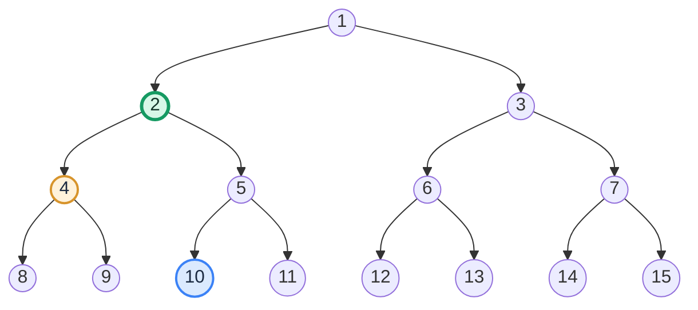
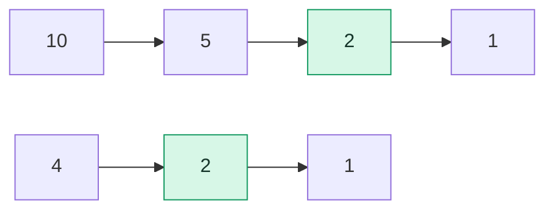
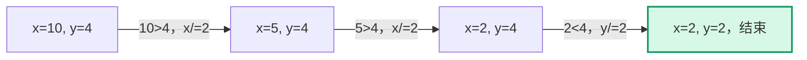

# 二叉树：最近公共祖先（LCA）学习笔记

> 题目关键词：二叉树、父结点、最近公共祖先、整数除法、模拟。  
> 题目样例：输入 `10 4`，输出 `2`。

## 1. 题目到底要我们做什么？

存在一棵由正整数 `1, 2, 3, …` 编号的**无限完全二叉树**。从根结点 `1` 开始，按层从左到右依次编号。

输入两个正整数 `x` 和 `y`（均不超过 1000），求它们从各自结点向根结点走时，**最近的那个共同结点**，也就是最近公共祖先（Lowest Common Ancestor，简称 **LCA**）。

- 祖先路径**包括结点自身**，因此一个结点也可以是自身的祖先。
- “最近”不是编号最小，而是**离原始结点更近、在树中更深**的公共祖先。
- 题目只要求输出这个结点的**编号**。

## 2. 先看图：树长什么样？

> **树形结构图**：下方的 Mermaid 图可在支持 Mermaid 的 Markdown 预览器中直接显示。

从图中可以观察到：

| 当前结点 `i` | 左孩子 | 右孩子 | 父结点（当 `i > 1` 时） |
| --- | --- | --- | --- |
| `i` | `2 * i` | `2 * i + 1` | `i / 2`（整数除法） |

例如：结点 `5` 的孩子是 `10、11`，而 `10` 的父结点是 `10 / 2 = 5`。结点 `1` 是根，没有父结点。

**关键规律：只需执行一次整数除法 `x /= 2`，就能让结点 `x` 向上走一层。**

### 不依赖图片的 Mermaid 树图（Markdown 渲染器支持 Mermaid 时可显示）



## 3. 样例：为什么 `10 4` 的答案是 `2`？

我们分别把两个结点不断除以 2，写出到根的路径：

```text
10 → 5 → 2 → 1
 4 → 2 → 1
```



两条路径的公共结点是 `2` 和 `1`。其中 `2` 比 `1` 更靠近起点 `10`、`4`，所以答案是 **2**。

## 4. 怎样不用建树、也不用 DFS，直接求出答案？

让两个结点向上走，直到编号相同。

**每次只移动编号比较大的那个结点：**

- 如果 `x > y`，就令 `x = x / 2`。
- 如果 `y > x`，就令 `y = y / 2`。
- 如果 `x == y`，就已经相遇，直接输出 `x`（输出 `y` 也一样）。



这里的过程是：

| 步骤 | `x` | `y` | 判断 | 操作 |
| ---: | ---: | ---: | --- | --- |
| 1 | 10 | 4 | `10 > 4` | `x = 10 / 2 = 5` |
| 2 | 5 | 4 | `5 > 4` | `x = 5 / 2 = 2` |
| 3 | 2 | 4 | `2 < 4` | `y = 4 / 2 = 2` |
| 4 | 2 | 2 | `x == y` | 结束，答案为 **2** |

注意：**并不是每一轮同时除以 2**，而是只让编号较大的那个结点向上走。

## 5. 完整 C++ 代码（详细注释）

```cpp
#include <iostream>
using namespace std;

int main() {
    int x, y;
    cin >> x >> y;  // 输入树中的两个结点编号

    // 只要两个结点还没有相遇，就继续向根结点移动
    while (x != y) {
        if (x > y) {
            // x 的编号更大，让 x 向上走一层
            // 根据编号规律，父结点就是 x / 2
            x /= 2;
        } else {
            // y 的编号更大，让 y 向上走一层
            y /= 2;
        }
    }

    // 循环结束时 x == y，它们相遇的位置就是最近公共祖先
    cout << x << endl;

    return 0;
}
```

### 逐行理解三句核心代码

```cpp
while (x != y)  // 两个结点还没走到一起
if (x > y)      // 哪个编号大，就让哪个结点往上走
x /= 2;         // 利用完全二叉树的编号规律找父结点
```

**不需要用数组存树，不需要 `struct`、`vector`、DFS 或回溯。** 题目的编号规律已经能直接算出父结点。

## 6. 为什么“每次让编号大的结点上移”是正确的？

在这棵树里，**任何结点的孩子编号都比父结点大**，所以某个结点的所有后代编号都比它大。

假如 `x > y`：

1. `x` 不可能是 `y` 的祖先，因为祖先的编号一定小于后代。
2. 两个结点的最近公共祖先不可能是 `x` 本身，一定在 `x` 的上方。
3. 因此，把 `x` 移到其父结点，不会跳过真正的最近公共祖先。

对 `y > x` 也同理。不断执行这个过程，第一次相遇的位置就是最近公共祖先。

## 7. 再做两个例子

**例 1：`14 11`**

```text
14 → 7 → 3 → 1
11 → 5 → 2 → 1
```

唯一的公共祖先是 `1`，因此输出：

```text
1
```

**例 2：`12 6`**

```text
12 → 6 → 3 → 1
 6 → 3 → 1
```

结点 `6` 本身就是结点 `12` 的祖先，所以输出：

```text
6
```

## 8. 复杂度与易错点

- **时间复杂度：** `O(log(max(x, y)))`。每向上一层，编号大致减半。
- **额外空间复杂度：** `O(1)`。只使用了少量整数变量。

常见错误：

1. 把父结点写成 `x - 1`。在这棵树中应该用 **`x / 2`**。
2. 把循环写成 `while (x > 1 && y > 1)`，可能在找到公共祖先前提前退出。应该使用 **`while (x != y)`**。
3. 以为“最近公共祖先”是编号最小的公共结点。实际上应该找**最深的**公共祖先。
4. 同时执行 `x /= 2; y /= 2;`。若两个结点原本不在同一层，这样可能错过最近公共祖先。

## 9. 一句话记忆

> **按层编号的二叉树，父结点 = 当前编号 ÷ 2（取整）；寻找最近公共祖先时，不断让编号大的结点除以 2，直到两者相等。**

---

### 自测

不看代码，试试输入 `18 13` 会输出多少？

<details>
<summary>点击查看答案</summary>

```text
18 → 9 → 4 → 2 → 1
13 → 6 → 3 → 1
```

因此答案是 `1`。
</details>

> 文件说明：本文件的示意图使用 Mermaid 语法，Markdown 软件需要支持 Mermaid 才能直接显示图形；如果需要更清晰的 PNG 图片，请下载完整图文包。
